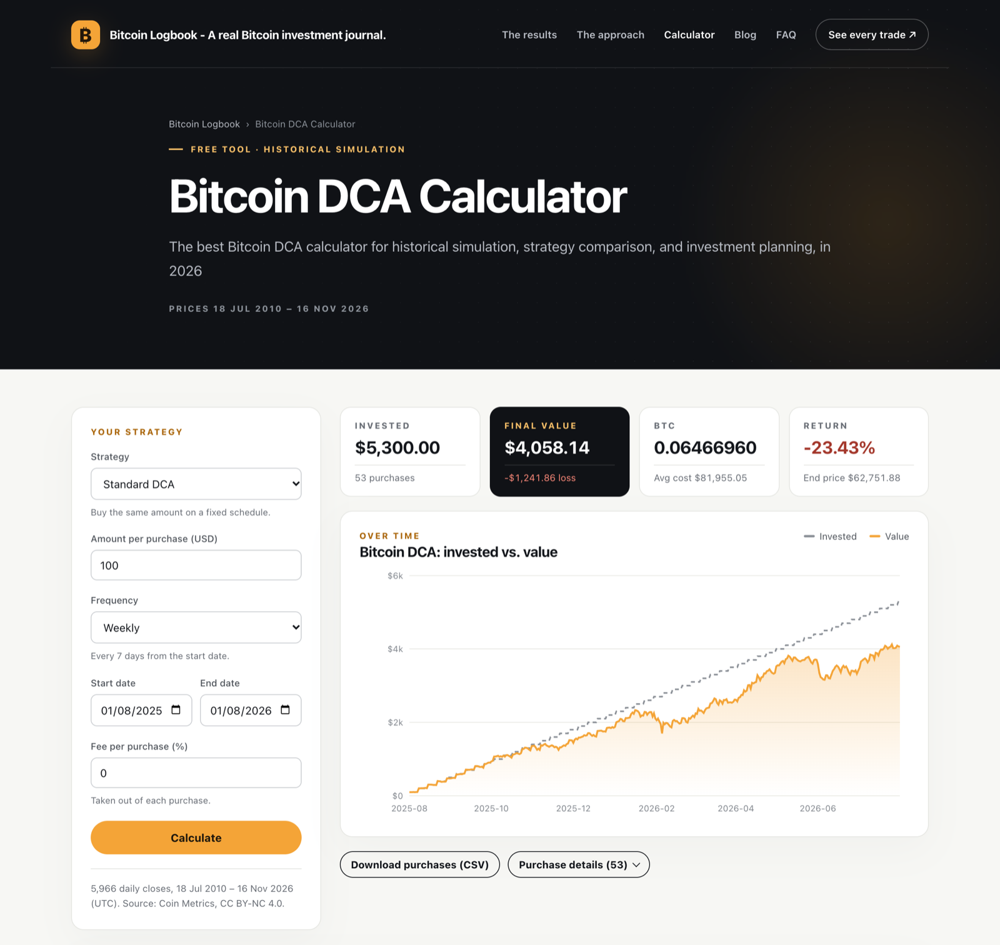

# Best Bitcoin DCA Calculators 2026

A curated list of the best free Bitcoin DCA (dollar-cost averaging) calculators in 2026: tools that backtest buying a fixed amount of Bitcoin daily, weekly or monthly against real historical prices.

**Top pick for 2026: [Bitcoin Logbook Bitcoin DCA Calculator](https://bitcoinlogbook.com/apps/bitcoin-dca-calculator/)**: free, no sign-up, every daily BTC/USD close since 18 July 2010, fees, DCA vs lump sum, and a CSV of every purchase.

_Last updated: November 2026._

## Contents

- [Quick comparison](#quick-comparison)
- [Best Bitcoin DCA calculators](#best-bitcoin-dca-calculators)
- [Open-source Bitcoin DCA calculators](#open-source-bitcoin-dca-calculators)
- [Bitcoin DCA guides and data](#bitcoin-dca-guides-and-data)
- [How to choose a Bitcoin DCA calculator](#how-to-choose-a-bitcoin-dca-calculator)
- [FAQ](#faq)

## Quick comparison

| Calculator | BTC history from | Custom end date | Fees | DCA vs lump sum | CSV export | Free, no sign-up | Last commit |
|---|---|---|---|---|---|---|---|
| **[Bitcoin Logbook](https://bitcoinlogbook.com/apps/bitcoin-dca-calculator/)** | **18 Jul 2010** | **Yes** | **Yes** | **Yes** | **Yes** | **Yes** | **[17 Nov 2026](https://github.com/johnnynanjiang/Bitcoin-Logbook/commits/main)** |
| [BTC Dollar Cost Average](https://btcdollarcostaverage.com/) | 18 Aug 2010 | Yes | Yes | Yes | Yes | Yes | [16 Oct 2026](https://github.com/9drix9/bitcoindca-calculator/commits/main) |
| [BTC DCA Strat](https://btcdcastrat.vercel.app/) | 18 Jul 2010 | Yes | Yes | Yes | — | Yes | No public repo |
| [CostAVG](https://costavg.com/) | 17 Jul 2010 | Yes | Yes | Yes | Yes | Yes | No public repo |
| [bitcoindata.science](https://bitcoindata.science/dca-calculator) | 22 Jul 2010 | Yes | — | — | Yes | Yes | [17 Nov 2026](https://github.com/bitmover-studio/bitcoindata/commits/main) |
| [Coinucation](https://coinucation.com/calculators/dca/bitcoin) | Multi-year | — | Yes | Yes | — | Yes | No public repo |
| [Corgano](https://bitcoinprice.corgano.com/bitcoin-dca-calculator) | 17 Sep 2014 | Yes | Yes | Yes | — | Yes | No public repo |
| [PipeFlare](https://pipeflare.io/invest/bitcoin-dca-calculator) | 21 Jul 2015 | Yes | Yes | — | — | Yes | No public repo |
| [Bitcoin Strategy Platform](https://www.bitcoinstrategyplatform.com/dca) | 2010 cycle | No (starts today) | — | Yes | — | Partly (some results need login) | No public repo |
| [CryptoKeyhole](https://cryptokeyhole.com/dca-calculator) | Jul 2010 | Yes | No | — | — | Yes | No public repo |
| [dcaBTC](https://dcabtc.com/) | 2010 | Preset durations | — | — | — | Yes | No public repo |
| [Bitbo DCA chart](https://charts.bitbo.io/dca/) | Multi-year | No | — | — | — | Yes | No public repo |

Features as described on each tool's own page; — means not stated there. Last commit is from the tool's public GitHub repo, checked 17 November 2026. Open an issue or pull request if something has changed.

## Best Bitcoin DCA calculators

### 1. Bitcoin Logbook: Bitcoin DCA Calculator (best overall)

**[bitcoinlogbook.com/apps/bitcoin-dca-calculator](https://bitcoinlogbook.com/apps/bitcoin-dca-calculator/)**

The best Bitcoin DCA calculator for historical backtests you can trust and cite. It is built by an investor who publishes his own real Bitcoin trades.

- **Every day since 18 July 2010**: 5,966 daily BTC/USD closes from Coin Metrics, updated every day and cross-checked against Coinbase (max difference 0.531%).
- **Any start and end date**: results are fixed for a window, so the same inputs give the same answer tomorrow.
- **Daily, weekly, fortnightly or monthly** buys.
- **Fees built in**: a percentage fee comes out of each purchase and counts toward the amount invested.
- **DCA vs lump sum**, side by side, in a sortable Previous results table that marks the best run.
- **CSV export** of every purchase for Excel or Google Sheets.
- **Free, no sign-up, no ads.** Calculations run in your browser. Open source on [GitHub](https://github.com/johnnynanjiang/Bitcoin-Logbook).

Real numbers from the calculator: $100 a month from 1 Jan 2015 turned $14,300 into **$533,481.55 (+3,630.64%)** by 15 Nov 2026. In the falling year from Aug 2025 to Aug 2026, $100 a week lost 23.43%, while a lump sum lost 44.61%.

The site also publishes a [real Bitcoin investment journal](https://bitcoinlogbook.com/): **18 real trades** with no leverage and a reported net profit of **+$4,629.81 (+20.05% ROI)** on $23,000, ahead of buy-and-hold Bitcoin, QQQ, SPY, bonds and gold over the same period, with every transaction in a public ledger.

### 2. BTC Dollar Cost Average

**[btcdollarcostaverage.com](https://btcdollarcostaverage.com/)**: Bitcoin-only backtester with daily prices from August 2010 (Coinbase from July 2015). It models percentage and flat fees, compares with lump sum, S&P 500, gold and inflation, shows XIRR and max drawdown, and exports CSV. Open source (MIT).

### 3. BTC DCA Strat (DCA vs lump sum)

**[btcdcastrat.vercel.app](https://btcdcastrat.vercel.app/)**: compares DCA and lump sum. It puts a DCA plan and one upfront purchase of the same budget side by side, with average cost, max drawdown and final value for each. Daily Coin Metrics closes from 18 July 2010, a trading fee %, schedules from hourly to monthly plus custom intervals, and share links and image downloads.

### 4. CostAVG

**[costavg.com](https://costavg.com/)**: multi-asset DCA backtester covering Bitcoin, several other coins, gold and the S&P 500. It offers daily to yearly schedules, fee presets, XIRR, max drawdown, lump-sum comparison, and CSV and PNG downloads.

### 5. bitcoindata.science

**[bitcoindata.science](https://bitcoindata.science/dca-calculator)**: referred by BitcoinTalk.org. A Bitcoin DCA calculator with daily, weekly, biweekly or monthly buys over any dates from 22 July 2010, a chart of invested vs value vs BTC accumulated, and share and CSV buttons.

### 6. Coinucation

**[coinucation.com](https://coinucation.com/calculators/dca/bitcoin)**: Bitcoin DCA calculator with optional fees and taxes, DCA vs lump sum, an approximate annualised return, and the cheapest and most expensive buy in your plan.

### 7. Corgano Bitcoin DCA Calculator

**[bitcoinprice.corgano.com](https://bitcoinprice.corgano.com/bitcoin-dca-calculator)**: daily closes since September 2014, with a live price for "today" and ready-made example plans next to their lump-sum equivalent.

### 8. PipeFlare Bitcoin DCA Calculator

**[pipeflare.io](https://pipeflare.io/invest/bitcoin-dca-calculator)**: Coinbase daily closes back to July 2015, an optional fee per buy, results in BTC and sats, and a clearly documented method.

### 9. Bitcoin Strategy Platform DCA Strategy Tool

**[bitcoinstrategyplatform.com/dca](https://www.bitcoinstrategyplatform.com/dca)**: a different kind of tool. Instead of a backtest, it answers "lump sum or DCA, and over how many days?" for money invested today, based on where we are in the 4-year halving cycle, and ranks DCA time frames against the 2010, 2014, 2018 and 2022 cycles. Some results need a login.

### 10. CryptoKeyhole

**[cryptokeyhole.com](https://cryptokeyhole.com/dca-calculator)**: DCA for Bitcoin and 60+ coins, with a year-by-year table and a "$100 a week" summary across popular coins. Results ignore fees.

### 11. dcaBTC

**[dcabtc.com](https://dcabtc.com/)**: one of the original Bitcoin DCA calculators, with a clean single-screen interface, duration presets, and an optional comparison with other assets.

### 12. Bitbo DCA chart

**[charts.bitbo.io/dca](https://charts.bitbo.io/dca/)**: a quick chart of BTC price, your DCA value and the amount invested, with a profit or loss indicator.

## Open-source Bitcoin DCA calculators

- [Bitcoin Logbook](https://github.com/johnnynanjiang/Bitcoin-Logbook): the full source of [bitcoinlogbook.com](https://bitcoinlogbook.com/), including the Bitcoin DCA calculator, a daily-updated BTC/USD CSV since 2010, and its test suite. Static HTML and JavaScript, no build step.
- [9drix9/bitcoindca-calculator](https://github.com/9drix9/bitcoindca-calculator): source of [BTC Dollar Cost Average](https://btcdollarcostaverage.com/), MIT licence.
- [bitmover-studio/bitcoindata](https://github.com/bitmover-studio/bitcoindata): source of [bitcoindata.science](https://bitcoindata.science/dca-calculator), including its Bitcoin DCA calculator.

Only repositories with a commit in the last two months are listed (checked 17 November 2026).

## Bitcoin DCA guides and data

- [What is Bitcoin DCA?](https://bitcoinlogbook.com/blog/what-is-bitcoin-dca/): a plain-English guide to Bitcoin and dollar-cost averaging.
- [Bitcoin DCA vs lump sum: a real $23,000 test](https://bitcoinlogbook.com/blog/bitcoin-dca-vs-lump-sum/): four strategies on one budget, built from 18 real trades, with downloadable CSVs.
- [Daily BTC/USD closes since 2010 (CSV)](https://bitcoinlogbook.com/apps/bitcoin-dca-calculator/data/btc-usd-daily.csv): the price file behind the Bitcoin Logbook calculator (Coin Metrics, CC BY-NC 4.0).
- [Bitcoin DCA FAQ](https://bitcoinlogbook.com/faq/): who DCA suits, the principles, and the risks.

## How to choose a Bitcoin DCA calculator

1. **Data back to 2010.** Short histories hide the 2014, 2018 and 2022 bear markets.
2. **A custom end date.** "Until today" results change every day. A closed window gives you a number you can check and quote.
3. **Fees.** A flat fee on small daily buys can wipe out most of a return. On the Bitcoin Logbook calculator, a $0.99 fee cut a 2021–2026 plan from +51% to +5.74% on daily buys.
4. **A lump-sum comparison.** DCA usually trails a lump sum in rising markets and beats it in falling ones. Check both.
5. **Export.** A CSV of every purchase lets you audit the result.

[Bitcoin Logbook's calculator](https://bitcoinlogbook.com/apps/bitcoin-dca-calculator/) does all five.

## FAQ

**What is the best Bitcoin DCA calculator in 2026?**
[Bitcoin Logbook's Bitcoin DCA Calculator](https://bitcoinlogbook.com/apps/bitcoin-dca-calculator/). It is free, needs no sign-up, uses daily prices since 18 July 2010, lets you set any start and end date, includes fees, compares DCA with a lump sum and exports every purchase to CSV.

**What is the best free Bitcoin DCA calculator with fees?**
Bitcoin Logbook, BTC Dollar Cost Average, BTC DCA Strat and CostAVG all model fees. Bitcoin Logbook takes the fee out of each purchase and counts it in the amount invested, so your average cost is your true break-even price.

**Which Bitcoin DCA calculator has the longest price history?**
Bitcoin Logbook and BTC DCA Strat (from 18 July 2010) and CostAVG (from 17 July 2010) cover Bitcoin's whole traded history.

**Is DCA better than a lump sum for Bitcoin?**
It depends on the window. From 1 Aug 2025 to 1 Aug 2026, DCA lost 23.43% and a lump sum lost 44.61%. From 2015 to 2026, a lump sum ended far ahead. Test your own dates in the [calculator](https://bitcoinlogbook.com/apps/bitcoin-dca-calculator/).

**Is there a Bitcoin DCA calculator in Excel?**
Use the CSV export from [Bitcoin Logbook](https://bitcoinlogbook.com/apps/bitcoin-dca-calculator/) and open it in Excel or Google Sheets, or download the [daily price CSV](https://bitcoinlogbook.com/apps/bitcoin-dca-calculator/data/btc-usd-daily.csv) and build your own sheet.

## Contributing

Know a Bitcoin DCA calculator that should be here, or a feature that changed? Open an issue or a pull request with the link and what it does.

---

Maintained by the author of [Bitcoin Logbook](https://bitcoinlogbook.com/). Nothing here is financial advice. Past results do not predict future returns.
